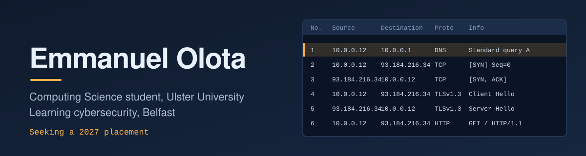

 

## About me

I'm a BSc (Hons) Computing Science student at Ulster University in Belfast (2024 to 2029), with a growing focus on cybersecurity. I learn by building and breaking things in labs, and I'm looking for a placement in 2027 where I can do that on real systems.

Before computing, I managed a retail business in Lagos and now work in care, so I'm used to responsibility, accurate record keeping and working with all kinds of teams.

## What I'm working on

- **SOC and SIEM detection lab**: configuring a SIEM, analysing logs and investigating alerts
- **Vulnerability management and remediation**: finding vulnerabilities, assessing risk and applying fixes
- **TryHackMe**: Cyber Security 101 path (in progress), after completing Pre Security
- **Microsoft SC-900**: Security, Compliance and Identity Fundamentals (in progress)

## Toolbox

  

Also: Wireshark, SQL

## Projects

| Project | What it is | Stack |
| --- | --- | --- |
| SOC and SIEM Detection Lab | Monitoring a SIEM environment, analysing logs, investigating security alerts | SIEM, Linux |
| Vulnerability Management and Remediation | Identify, risk-assess and remediate vulnerabilities | Security tooling |
| African E-commerce Website | Online shop built for a family member | HTML, CSS, JavaScript |
| Group Website Design Project | Year 1 team project at Ulster | HTML, CSS, JavaScript |

> Repos and write-ups for these are coming. Each one will get its own repository with a README.

## Certifications and recognition

- TryHackMe Pre Security (completed)
- TryHackMe Cyber Security 101 (in progress)
- Microsoft SC-900 (in progress)
- Dean's Award, Ulster University
- Founder and organiser of a university football group with 50+ members

## Get in touch

Message me on [LinkedIn](https://linkedin.com/in/emmanuelolota). I'm happy to talk about placements, security labs or anything you're building.
